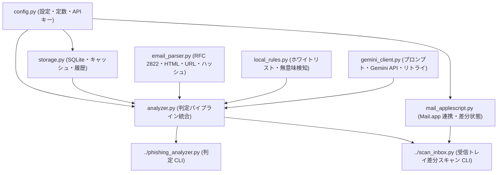

# `mail_phishing_filter` モジュール機能仕様・アーキテクチャ

このドキュメントは、人間および AI アシスタントが本パッケージを安全に保守・拡張するためのモジュール単位の機能仕様書です。

## 依存関係（循環依存なしの一方向 DAG）

---

## モジュール別仕様

### 1. `config.py`（98行）— 設定・パス・認証情報管理
- **責務**: 全モジュールで共有する定数・デフォルト設定の定義、ユーザー設定ファイル読み込み、Gemini API キーの安全な取得。
- **主な公開シンボル**:
  - `CONFIG_DIR` (`~/.config/mail-phishing-filter`), `CONFIG_PATH`, `CACHE_DB_PATH`, `HISTORY_LOG_PATH`, `STATE_PATH`, `KEYCHAIN_SERVICE`
  - `DEFAULT_CONFIG`: モデル名、判定しきい値、バッチサイズ、大量送信しきい値、ホワイトリスト設定の既定値
  - `load_config(config_path)` / `save_default_config_if_missing(config_path)`
  - `get_api_key() -> str | None`: **環境変数 (`GEMINI_API_KEY` / `GOOGLE_API_KEY`) → macOS キーチェーン → `api_key` ファイル** の優先順で取得
- **変更時の注意点**: 新しい設定項目を追加する場合は `DEFAULT_CONFIG` に既定値を入れ、`load_config()` のマージ機構をそのまま使うこと。

### 2. `email_parser.py`（326行）— 生メール解析・特徴抽出
- **責務**: RFC 2822 生メールバイト列（`.eml`）を解析し、ローカルルールおよび LLM 判定に使う構造化特徴量辞書へ変換する。
- **主な公開シンボル**:
  - `parse_raw_email(raw_bytes: bytes, cfg: dict) -> dict`:
    - `From`（表示名・実アドレス・ドメイン）、`Reply-To`、`Return-Path`、`Subject`、`Date`（`date_ts` Unix秒）、`Message-ID`
    - 認証ヘッダー（`Authentication-Results`, `ARC-Authentication-Results`, `Received-SPF`, `DKIM-Signature`）から SPF / DKIM / DMARC 状態と署名ドメインを抽出
    - HTML パートから可視テキスト、`` の表示テキストと実 `href` の不一致・Punycode (`xn--`) を抽出
    - 機械的な異常メモ（`heuristic_notes`）、重複排除キー（`cache_key`）、同一内容検知ハッシュ（`content_hash`）を生成
  - `compute_content_fingerprint(subject, body_text, min_chars=30) -> str`:
    - URL・メールアドレス・数字列をプレースホルダ化して正規化 SHA-256 を生成（30文字未満の短文は誤爆防止のため空文字を返す）
- **変更時の注意点**: 正規表現はモジュール先頭で事前コンパイルしている。重い処理を追加する場合は 1通あたり 1ms 程度を目安に保つこと。

### 3. `local_rules.py`（87行）— API不要のローカル即時ルール
- **責務**: Gemini API を呼ばずにローカルで即決できるルール判定を提供する。
- **主な公開シンボル**:
  - `prepare_whitelist(cfg)` / `matches_whitelist(...)` / `is_whitelisted(parsed, cfg) -> bool`:
    - ホワイトリスト一致判定。`whitelist_require_auth=True`（既定）時は SPF/DKIM/DMARC のいずれかが `pass` かつ `fail` が無い場合のみ許可し、From 偽装による突破を防ぐ。
  - `detect_obvious_nonsense(parsed) -> str | None`:
    - 添付ファイル付き、`` 付き HTML、`Re:`/`Fwd:`/`Fw:` の返信転送は誤爆防止のため即スキップ。
    - それ以外で「件名・本文とも実質空」「文字化け置換文字（`\ufffd`）が30%以上」「同一文字30回以上連続が本文50%以上」「日本語を含まない60文字以上の長大ランダム英数字塊が80%以上」を検知して理由文を返す。
- **変更時の注意点**: 人間が書いた自然な短文返信を誤爆しないよう、微妙な文章の判定はローカルではなく `gemini_client.py` のプロンプトに委ねること。

### 4. `storage.py`（224行）— SQLite 永続化・バースト集計・履歴ログ
- **責務**: 判定結果キャッシュ、大量送信検知用の受信イベント記録、JSONL 判定履歴ログの読み書き。
- **テーブル設計（`cache.sqlite3`）**:
  - `verdicts (cache_key PK, created_at, result_json)`: `Message-ID` ベースの判定結果キャッシュ
  - `sender_events (from_addr, cache_key PK, event_ts)`: 同一送信元バースト検知用（同一メール重複防止）
  - `content_events (content_hash, cache_key PK, from_addr, event_ts)`: 異アドレス含む同一内容バースト検知用
- **主な公開シンボル**:
  - `open_db_session(db_path)`: WAL モード（`PRAGMA journal_mode=WAL` / `busy_timeout=15000`）で1接続を使い回し、終了時に30日超の古いレコードを一括削除してコミットするコンテキストマネージャ
  - `record_sender_events` / `count_sender_burst`: スライディングウィンドウで指定メールを含む任意区間（`window_seconds`）の最大通数を算出
  - `record_content_events` / `count_content_burst`: 同様に `(最大通数, ユニーク送信元数)` を算出
  - `get_cached_result` / `put_cached_result` / `append_history_batch`
- **変更時の注意点**: SQLite 接続は必ず `open_db_session()` 経由で短時間トランザクションに保ち、外部 API 通信などのネットワーク待ちの間はロックを保持しないこと。

### 5. `gemini_client.py`（307行）— Gemini Interactions API 通信
- **責務**: システムプロンプト・Structured Output JSON スキーマの定義、Interactions API (`v1`, `store=False`) の呼び出し、一時エラーのリトライ制御。
- **主な公開シンボル**:
  - `SYSTEM_INSTRUCTION`, `RESPONSE_SCHEMA`, `BATCH_RESPONSE_SCHEMA`
  - `build_analysis_prompt(parsed)` / `build_batch_analysis_prompt(parsed_list)`
  - `RetryableAPIError`: HTTP 429 / 500 / 502 / 503 / 504 やネットワーク一時障害を表す例外
  - `call_gemini_with_retry(...)`: `google-genai` SDK があれば SDK 経由、未インストール時は標準ライブラリ `urllib.request` で `POST https://generativelanguage.googleapis.com/v1/interactions` を直接呼び出し、指数バックオフ（5s → 12s → 25s → 45s、最大65s、`Retry-After` 尊重）で最大 `max_retries` 回リトライ
- **変更時の注意点**: プライバシー保護のため `store=False` を必ず維持すること。モデル名変更時は `config.py` の `DEFAULT_CONFIG["model"]` を変更する。

### 6. `analyzer.py`（452行）— 判定パイプライン統合
- **責務**: 上記5モジュールを組み合わせ、メール1通または複数通の最終判定とアクション決定を行う中核オーケストレータ。
- **判定優先順位**:
  1. ホワイトリスト（認証通過済み）→ `OK`
  2. 同一送信元の単位時間内大量送信（既定：10分8通）→ `JUNK`（API不要）
  3. 異アドレス含む同一内容の大量送信（既定：60分3通・送信元2件以上、または8通以上）→ `JUNK`（API不要）
  4. 明確な機械的無意味メール → `JUNK`（API不要）
  5. SQLite キャッシュヒット → キャッシュ結果に現在のしきい値・`dry_run` を再適用
  6. 未判定メールを件数上限（`batch_size`）＆合計本文長上限（`max_batch_body_chars`）でチャンク分割し、バッチで Gemini 判定（エラー・部分欠落時はフェイルセーフで `ERROR` / 受信トレイ維持）
- **主な公開シンボル**:
  - `analyze_emails_batch(...) -> list[dict]`
  - `analyze_email_bytes(...) -> dict`
  - `decide_action(llm_result, cfg, dry_run) -> "JUNK" | "SUSPICIOUS" | "OK"`
  - `format_applescript_line(result) -> str`（`ACTION|CONFIDENCE|VERDICT|BRAND|REASON`）

### 7. `mail_applescript.py`（426行）— Mail.app 連携・差分状態管理
- **責務**: macOS 標準「メール」アプリを操作する AppleScript 群の定義・実行と、アカウントごとの前回スキャン日時（`scan_state.json`）の管理。
- **主な公開シンボル**:
  - AppleScript 定数: `LIST_ACCOUNTS_SCRIPT`, `DUMP_ACCOUNT_INBOX_SCRIPT`, `DUMP_SELECTED_SCRIPT`, `APPLY_ACCOUNT_ACTIONS_SCRIPT`
  - `list_accounts()` / `dump_account_inbox(...)` / `dump_selected_messages(...)`
  - `apply_actions_batched(actions_by_account, search_window)`: アカウントあたり1回の `osascript` 起動で1パス走査→オブジェクト参照収集→一括移動/ハイライトを実行
  - `is_mail_app_running()` / `send_macos_notification(title, message)`: Mail.app 起動確認（`pgrep -x Mail`）および引数配列経由の安全な macOS 通知表示
  - `load_scan_state` / `save_scan_state` / `update_account_watermark`
- **変更時の注意点**: AppleScript を編集した場合は必ず `/usr/bin/osacompile` で Mail.app 辞書付きの構文検証を行うこと（`message id X` のような Mail.app 非対応構文を避ける）。

---

## エントリポイント（リポジトリルート）

- `../phishing_analyzer.py`（116行）: 単体／`--batch` 判定 CLI。`mail_rule.applescript`（Mail.app ルール）から直接呼ばれる。
- `../scan_inbox.py`（279行）: Mail.app の全アカウント受信トレイを対象とした差分スキャン・一括適用 CLI。
- `../mail_rule.applescript`（176行）: Mail.app ルール用テンプレート（`./setup.sh install` で `__PROJECT_DIR__` を展開して `PhishingFilter.scpt` にコンパイル）。
- `../setup.sh`（138行）: キーチェーンへの API キー登録、Mail.app スクリプトのインストール、ホワイトリスト追加、ログ・状態確認 CLI。
